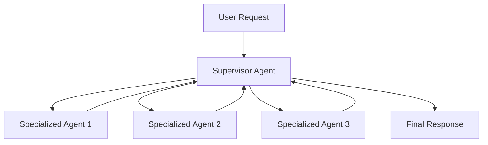

# 🛡️ TriAgent RiskGuard
### Multi-Agent AI System for Intelligent Support and Risk Management

A Python-based AI project exploring multi-agent orchestration, LLM integration, semantic retrieval, and risk-management workflows.

**TriAgent RiskGuard** is designed around the idea of using multiple specialized AI agents to support complex tasks through coordinated decision-making. The project also explores configurable language models, embedding-based retrieval, and locally hosted LLMs.

---

## 🚀 Project Overview

Modern AI applications often need more than a single language model to handle complex tasks effectively.

A multi-agent architecture provides a way to separate responsibilities, coordinate specialized components, and make AI workflows easier to extend and maintain.

This project explores the combination of:

- Multi-agent AI workflows
- Supervisor-based agent coordination
- AI-assisted support and risk management
- LLM integration through configurable API settings
- Embedding models and semantic retrieval
- Local LLM experimentation with Ollama

The goal is to develop a modular foundation for building AI-powered systems that can support more structured and maintainable workflows.

## ✨ Key Technologies

| Technology | Purpose |
|---|---|
| Python | Core application development |
| OpenAI-compatible API | Language model integration |
| Ollama | Local LLM integration |
| ChromaDB | Vector database technology |
| Embeddings | Semantic representation and retrieval |
| Environment Variables | Configuration and API key management |

## 🧠 AI Architecture

The project explores a multi-agent approach in which different agents can be assigned specialized responsibilities.

### Agent-Based Workflow

The intended architectural direction is to separate task handling into specialized components coordinated through a supervisory layer.



*Note: This diagram illustrates the intended multi-agent architecture, not a verified representation of every execution path in the current implementation.*

## 🔎 Semantic Retrieval

The project configuration includes embedding-model settings, a rules document path, and vector-storage configuration.

These components provide a foundation for experimenting with retrieval-based AI workflows.

A retrieval-augmented workflow can help an application retrieve relevant information before generating a response, rather than relying exclusively on the language model's internal knowledge.

## 🤖 Flexible LLM Configuration

The configuration supports an OpenAI-compatible API interface and includes settings for chat and embedding models.

It also defines a local Ollama endpoint and a configurable local model.

This provides a starting point for experimenting with different inference environments, including API-based models and locally hosted models.

## 🛠️ Installation

### 1. Clone the Repository

```bash
git clone https://github.com/behrouzyou/AISupport-with-3Agent-sup-mang-risk-.git
cd AISupport-with-3Agent-sup-mang-risk-
```

### 2. Create a Virtual Environment

**Windows:**

```powershell
python -m venv .venv
.venv\Scripts\activate
```

**Linux / macOS:**

```bash
python -m venv .venv
source .venv/bin/activate
```

### 3. Install Dependencies

```bash
pip install -r requirements.txt
```

### 4. Configure Environment Variables

Create a `.env` file in the project root and configure the variables expected by the application.

Example:

```env
OPENAI_API_KEY=your_api_key
OPENAI_CHAT_MODEL=your_chat_model
OPENAI_EMBEDDING_MODEL=your_embedding_model
BASE_URL=your_api_base_url
```

Replace the example values with your actual configuration.

**Security:** Never commit your `.env` file or expose API keys in source code.

### 5. Configure Local Inference (Optional)

The current configuration defines the following local Ollama settings:

```python
BASE_OLLAMA_URL = "http://localhost:11434"
OLLAMA_MODEL = "qwen3.5:9b"
```

To use local inference, ensure Ollama is installed, the configured model is available, and the application is configured to use the local endpoint where appropriate.

## 📁 Configuration

The `config.py` module centralizes several application settings, including:

- API credentials and model names
- Base URL for an OpenAI-compatible API
- Rules document location
- Chunk size
- Vector database path and collection name
- Local Ollama endpoint and model

Centralizing these settings helps keep configuration separate from application logic.

## 🔐 Security Considerations

- Store API credentials in environment variables.
- Keep `.env` files out of version control.
- Validate model-generated data before using it in application operations.
- Apply appropriate access controls before exposing AI services publicly.
- Evaluate model outputs before using them in risk-sensitive workflows.

## 🗺️ Future Development

Potential directions for further development include:

- More explicit agent orchestration and delegation
- Improved supervisor decision-making
- Retrieval evaluation and relevance optimization
- Structured outputs and response validation
- Better observability and agent execution tracing
- Automated testing for individual agents and workflows
- Evaluation of local and API-based language models
- More robust handling of uncertain or conflicting agent responses

## 🎯 Project Goals

This project is part of an exploration of practical AI engineering, with an emphasis on:

- Agentic AI
- Multi-agent system design
- LLM application development
- Semantic search and retrieval
- Model integration and configuration
- Modular Python architecture

## 👨‍💻 Author

**Behrouz**

GitHub: [@behrouzyou](https://github.com/behrouzyou)

---

*Built as an AI engineering project focused on exploring coordinated AI agents, language models, and retrieval-based workflows.*
